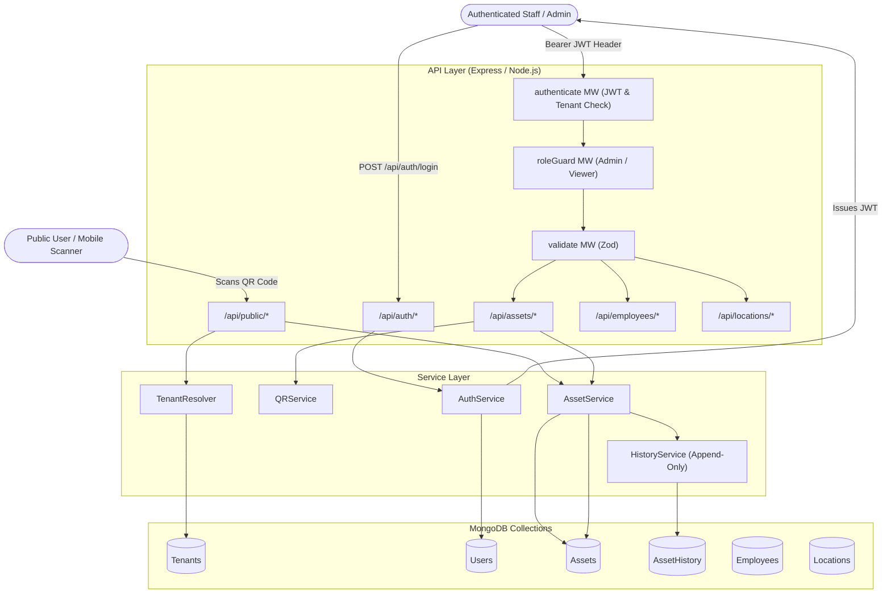

# QR Asset Tracker — Codebase & Architecture Analysis

This document provides a comprehensive technical analysis of the **QR Asset Tracker** codebase (`c:/Users/Administrator/Desktop/QR Asset/QR-Asset-Tracker`).

---

## 1. System Overview & Technology Stack

The **QR Asset Tracker** is a multi-tenant B2B asset tracking backend application built with **Node.js**, **Express**, and **MongoDB (via Mongoose)**.

### Primary Technologies
- **Runtime & Server**: Node.js, Express 4.19.2 ([app.js](file:///c:/Users/Administrator/Desktop/QR%20Asset/QR-Asset-Tracker/backend/src/app.js), [server.js](file:///c:/Users/Administrator/Desktop/QR%20Asset/QR-Asset-Tracker/backend/src/server.js))
- **Database & ODM**: MongoDB with Mongoose 8.4.1 ([database.js](file:///c:/Users/Administrator/Desktop/QR%20Asset/QR-Asset-Tracker/backend/src/config/database.js))
- **Authentication & Security**: JWT (JSON Web Tokens via `jsonwebtoken`), `bcryptjs` (password hashing with cost factor 12/4)
- **Validation**: `zod` schema validation ([schemas.js](file:///c:/Users/Administrator/Desktop/QR%20Asset/QR-Asset-Tracker/backend/src/validation/schemas.js))
- **QR Code Generation**: `qrcode` package + Node.js native `crypto.randomBytes(32)` ([qrService.js](file:///c:/Users/Administrator/Desktop/QR%20Asset/QR-Asset-Tracker/backend/src/services/qrService.js))
- **Testing**: Jest 29.7.0 + Supertest 7.0.0 (69 unit & integration tests passing)

---

## 2. Directory Structure

```
QR-Asset-Tracker/
├── .env                              # Workspace environment variables
├── .kiro/
│   └── architecture/
│       └── architecture-diagram.mmd  # Architecture diagram in Mermaid format
└── backend/
    ├── .env.example                  # Environmental variable template
    ├── package.json                  # Scripts & dependencies
    └── src/
        ├── app.js                    # Express app definition & middleware wiring
        ├── server.js                 # Database connection & server entrypoint
        ├── config/
        │   ├── constants.js          # Enums, statuses, token regex patterns
        │   └── database.js           # Mongoose connection manager
        ├── models/                   # Mongoose Data Models
        │   ├── Tenant.js             # Organization tenant schema
        │   ├── User.js               # Staff user account schema
        │   ├── Employee.js           # Employee schema (assignment target)
        │   ├── Location.js           # Physical location schema (assignment target)
        │   ├── Asset.js              # Physical asset schema
        │   └── AssetHistory.js       # Immutable append-only audit trail schema
        ├── middleware/
        │   ├── asyncWrapper.js       # Controller async error handler wrapper
        │   ├── authenticate.js       # JWT & tenant active status verifier
        │   ├── roleGuard.js          # RBAC (Admin vs Viewer) guard factory
        │   ├── validate.js           # Zod input validation middleware factory
        │   └── errorHandler.js       # AppError class & global error handler
        ├── controllers/
        │   ├── auth.controller.js    # Login route handler
        │   ├── asset.controller.js   # Asset CRUD, assignment, status, QR handlers
        │   ├── employee.controller.js# Employee read handlers
        │   ├── location.controller.js# Location read handlers
        │   └── public.controller.js  # Unauthenticated public QR scan handler
        ├── services/
        │   ├── authService.js        # User auth & JWT issuance
        │   ├── assetService.js       # Asset business logic & state transitions
        │   ├── qrService.js          # Cryptographic token & QR image generation
        │   ├── historyService.js     # Append-only history writer
        │   ├── employeeService.js   # Employee lookup & field visibility filtering
        │   ├── locationService.js    # Location lookup service
        │   └── tenantResolver.js     # Public scan tenant parameter resolver
        ├── validation/
        │   └── schemas.js            # Zod validation schemas for all routes
        ├── scripts/
        │   ├── seed.js               # Idempotent demo database seeder
        │   └── e2e-verify.js         # End-to-end integration test runner
        └── tests/                    # Jest test suite (6 test suites, 69 tests)
```

---

## 3. High-Level Architecture & Workflow



---

## 4. Multi-Tenancy & Data Models

All models except `Tenant` enforce tenant isolation by storing a required `tenantId` field and using compound indexes prefixed with `tenantId`.

### Data Schemas

1. **[Tenant](file:///c:/Users/Administrator/Desktop/QR%20Asset/QR-Asset-Tracker/backend/src/models/Tenant.js)**:
   - `name`: Organization name (e.g. "Meridian Operations").
   - `slug`: Unique lowercase slug (`^[a-z0-9-]+$`).
   - `isActive`: Boolean flag. If `false`, all JWT requests and public scans for this tenant are rejected.

2. **[User](file:///c:/Users/Administrator/Desktop/QR%20Asset/QR-Asset-Tracker/backend/src/models/User.js)**:
   - `tenantId`: Reference to `Tenant`.
   - `name`, `email` (unique), `passwordHash` (hashed with `bcryptjs`), `role` (`Admin` or `Viewer`).
   - `passwordHash` and `tenantId` are stripped from JSON outputs.

3. **[Employee](file:///c:/Users/Administrator/Desktop/QR%20Asset/QR-Asset-Tracker/backend/src/models/Employee.js)**:
   - `tenantId`: Reference to `Tenant`.
   - `name`, `title`, `department`, `contactInfo` (`{ email, phone }`), `status` (`active` | `inactive`).
   - `contactInfo` is hidden for non-Admin users and excluded from bulk list endpoints.

4. **[Location](file:///c:/Users/Administrator/Desktop/QR%20Asset/QR-Asset-Tracker/backend/src/models/Location.js)**:
   - `tenantId`: Reference to `Tenant`.
   - `name`, `type` (`site` | `building` | `zone` | `room` | `other`), `address`.

5. **[Asset](file:///c:/Users/Administrator/Desktop/QR%20Asset/QR-Asset-Tracker/backend/src/models/Asset.js)**:
   - `tenantId`: Reference to `Tenant`.
   - `qrToken`: Cryptographically random 64-char hex string (unique).
   - `assetCode`: Organization-unique code (e.g. `AST0001`).
   - `name`, `category` (`Laptop` | `Vehicle` | `Tool` | `Furniture` | `Equipment`).
   - `description`, `serialNumber`.
   - `status` (`Available` | `Assigned` | `In Repair` | `Retired` | `Lost`).
   - `assignedEmployeeId`: Reference to `Employee` (or `null`).
   - `assignedLocationId`: Reference to `Location` (or `null`).
   - `isPublicVisible`: Boolean (controls public QR scan availability).

6. **[AssetHistory](file:///c:/Users/Administrator/Desktop/QR%20Asset/QR-Asset-Tracker/backend/src/models/AssetHistory.js)** (**Strictly Append-Only**):
   - `tenantId`, `assetId`, `performedBy` (User ObjectId).
   - `eventType`: `Created`, `StatusChange`, `AssignedToEmployee`, `AssignedToLocation`, `Unassigned`, `Updated`.
   - `previousValue`, `newValue` (Mixed objects storing state deltas).
   - `note`: Optional string note (max 500 chars).
   - *No update or delete operations are implemented for this collection.*

---

## 5. Security & Permission Matrix

| Role | Access Permissions |
|---|---|
| **Public Scanner** | Unauthenticated `GET /api/public/scan/:qrToken?t=<tenantId>`. Returns sanitized public asset details if `isPublicVisible: true`. Never returns internal DB IDs, `qrToken`, or employee `contactInfo`. |
| **Viewer** | Authenticated read-only access. Can view asset list/details, locations, employees, and history logs. `contactInfo` on employees is omitted. Cannot request base64 QR code image unless Admin. |
| **Admin** | Full read/write access. Can create assets, edit metadata, assign/unassign assets, change status, regenerate QR codes, request QR code base64 images, and view employee `contactInfo`. |

---

## 6. Complete API Endpoint Reference

### 6.1 Unauthenticated Public Routes ([public.routes.js](file:///c:/Users/Administrator/Desktop/QR%20Asset/QR-Asset-Tracker/backend/src/routes/public.routes.js))

#### `GET /api/public/scan/:qrToken?t=<tenantId>`
- **Auth**: None
- **Query Params**: `t` (required 24-char ObjectId string)
- **Path Params**: `qrToken` (64-char lowercase hex string)
- **Behavior**: Returns asset profile if `isPublicVisible === true`. Malformed tokens or inactive tenants return `404 NOT_FOUND` (preventing format leakage).
- **Response Format (`200 OK`)**:
  ```json
  {
    "data": {
      "assetCode": "AST0001",
      "name": "Dell XPS 15 Laptop",
      "category": "Laptop",
      "description": "Developer laptop",
      "status": "Assigned",
      "assignedTo": {
        "type": "employee",
        "displayName": "Alice Fernandez",
        "title": "Operations Manager"
      }
    }
  }
  ```

---

### 6.2 Authentication Routes ([auth.routes.js](file:///c:/Users/Administrator/Desktop/QR%20Asset/QR-Asset-Tracker/backend/src/routes/auth.routes.js))

#### `POST /api/auth/login`
- **Auth**: None
- **Body**:
  ```json
  {
    "email": "user@example.com",
    "password": "Password123!"
  }
  ```
- **Response Format (`200 OK`)**:
  ```json
  {
    "data": {
      "token": "eyJhbGciOiJIUzI1NiIsInR5cCI6...",
      "expiresIn": 86400,
      "user": {
        "id": "66d82f7c0000000000000001",
        "name": "Admin User",
        "email": "admin@example.com",
        "role": "Admin"
      }
    }
  }
  ```

---

### 6.3 Asset Management Routes ([asset.routes.js](file:///c:/Users/Administrator/Desktop/QR%20Asset/QR-Asset-Tracker/backend/src/routes/asset.routes.js))

All asset routes require `Authorization: Bearer <token>` header.

#### `GET /api/assets`
- **Role**: Admin, Viewer
- **Query Params**: `page` (default 1), `limit` (default 20, max 100), `status`, `category`, `assignedEmployeeId`, `assignedLocationId`, `search`, `isPublicVisible`
- **Response (`200 OK`)**: Paginated list of assets (`{ data: [...], meta: { page, limit, total, totalPages } }`). `qrToken` is excluded.

#### `POST /api/assets`
- **Role**: Admin only
- **Body**:
  ```json
  {
    "name": "MacBook Pro 16",
    "category": "Laptop",
    "description": "M3 Max 36GB",
    "serialNumber": "C02G1234MD6R",
    "isPublicVisible": true,
    "assetCode": "AST0099" // optional, auto-generated if omitted
  }
  ```
- **Response (`201 Created`)**: Created asset object including `qrCodeUrl`.

#### `GET /api/assets/:id`
- **Role**: Admin, Viewer
- **Query Params**: `includeQrImage=true` (Admin only)
- **Response (`200 OK`)**: Single asset details. If Admin and `includeQrImage=true`, returns `qrCodeImageBase64` data URL.

#### `PATCH /api/assets/:id`
- **Role**: Admin only
- **Body**: `name`, `category`, `description`, `serialNumber`, `isPublicVisible` (at least 1 required)
- **Response (`200 OK`)**: Updated asset object. Writes `Updated` history log.

#### `GET /api/assets/:id/history`
- **Role**: Admin, Viewer
- **Query Params**: `page`, `limit`, `eventType`
- **Response (`200 OK`)**: Paginated append-only history logs for the asset.

#### `POST /api/assets/:id/assign`
- **Role**: Admin only
- **Body**:
  ```json
  {
    "employeeId": "66d82f7c0000000000000002", // OR locationId, mutually exclusive!
    "note": "Assigned for remote work"
  }
  ```
- **Behavior**: Sets asset status to `Assigned`, records `AssignedToEmployee` or `AssignedToLocation` history event. Enforces active employee checks and assignment exclusivity.

#### `POST /api/assets/:id/unassign`
- **Role**: Admin only
- **Body**: `{ "note": "Returned after project" }`
- **Behavior**: Clears employee/location assignments, sets status to `Available`, records `Unassigned` history event. Idempotent if already unassigned.

#### `POST /api/assets/:id/status`
- **Role**: Admin only
- **Body**: `{ "status": "In Repair", "note": "Screen replacement" }`
- **Behavior**: Updates asset status. Validates transition rules (e.g. cannot set `Available` if still assigned; cannot modify `Retired` assets).

#### `POST /api/assets/:id/qr/regenerate`
- **Role**: Admin only
- **Behavior**: Invalidates previous `qrToken`, generates fresh 64-char hex token, returns new `qrCodeUrl` and `qrCodeImageBase64`. Logs `Updated` event.

---

### 6.4 Employee Routes ([employee.routes.js](file:///c:/Users/Administrator/Desktop/QR%20Asset/QR-Asset-Tracker/backend/src/routes/employee.routes.js))

#### `GET /api/employees`
- **Role**: Admin, Viewer
- **Query Params**: `page`, `limit`, `status`, `department`, `search`
- **Behavior**: Returns paginated employees. `contactInfo` is always excluded in list view.

#### `GET /api/employees/:id`
- **Role**: Admin, Viewer
- **Behavior**: Returns single employee details. `contactInfo` is included **only if the requester has the Admin role**.

---

### 6.5 Location Routes ([location.routes.js](file:///c:/Users/Administrator/Desktop/QR%20Asset/QR-Asset-Tracker/backend/src/routes/location.routes.js))

#### `GET /api/locations`
- **Role**: Admin, Viewer
- **Query Params**: `page`, `limit`, `type`, `search`
- **Behavior**: Returns paginated physical locations.

#### `GET /api/locations/:id`
- **Role**: Admin, Viewer
- **Behavior**: Returns single location object.

---

## 7. Business Edge Cases & Rules Matrix

| Code | Scenario | Enforced Logic & HTTP Status |
|---|---|---|
| **EC-01** | Duplicate `assetCode` on creation | Returns `409 Conflict`. Unique compound index `{ tenantId: 1, assetCode: 1 }` handles race conditions. |
| **EC-02** | Invalid/Non-existent `qrToken` | Returns `404 NOT_FOUND` ("Asset not found."). |
| **EC-03** | Malformed `qrToken` (not 64-char hex) | Route layer intercepts format failure and returns `404 NOT_FOUND` (not 422) to avoid token format leakage. |
| **EC-04** | `isPublicVisible: false` scan | Returns `404 NOT_FOUND`. |
| **EC-05** | Assigning an already-assigned asset | Returns `409 Conflict`. Caller must call `/unassign` first. |
| **EC-06** | Both `employeeId` AND `locationId` provided | Returns `422 Validation Error` via Zod schema `.refine()`. |
| **EC-07** | Mutating a `Retired` asset | Returns `409 Conflict`. `Retired` is a terminal state. |
| **EC-10** | Empty search or filter results | Returns `200 OK` with `data: []` and accurate `meta` pagination stats. |
| **EC-11** | Assigning to inactive/cross-tenant employee | Inactive employee returns `409 Conflict`. Cross-tenant employee returns `404 NOT_FOUND`. |
| **EC-12** | Inactive organization tenant | Returns `401 Unauthorized` ("Organization account is inactive."). Checked on login and on every JWT request. |
| **EC-13** | Setting status to `Available` while assigned | Returns `409 Conflict`. Must unassign first. |

---

## 8. Database Seeding & Verification

### Running the Seed Script
```bash
npm run seed
```
Creates:
- 1 Organization Tenant (`meridian-ops`)
- 2 Staff Accounts (`admin@meridian-ops.example`, `viewer@meridian-ops.example`)
- 8 Employees & 5 Locations
- 24 Pre-populated Assets with full history events

### Running Tests
```bash
npm test
```
Executes Jest test suites covering authentication, role authorization, asset state transitions, public scanning, and edge cases.
